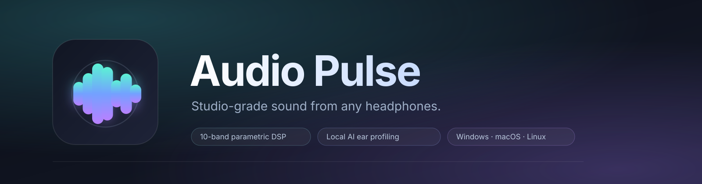
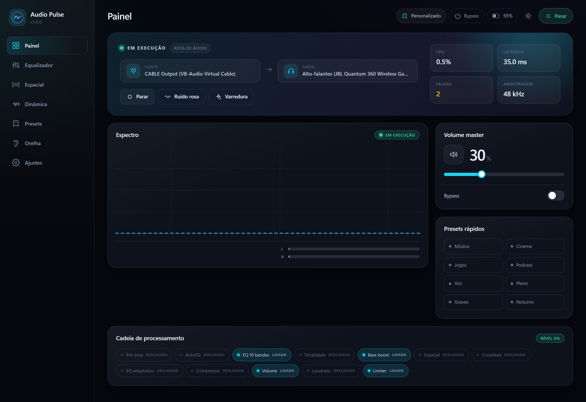
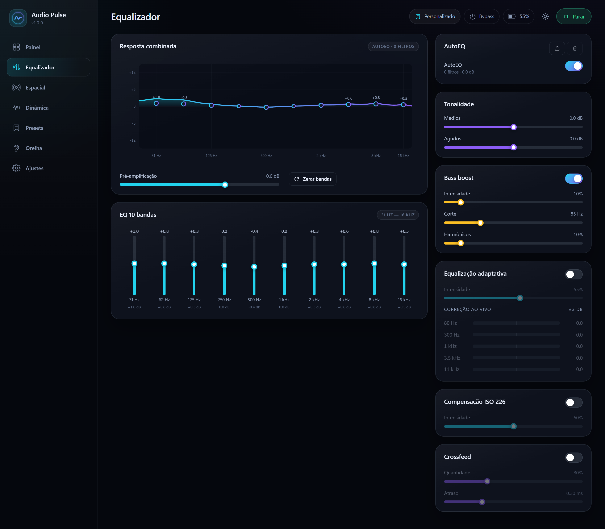
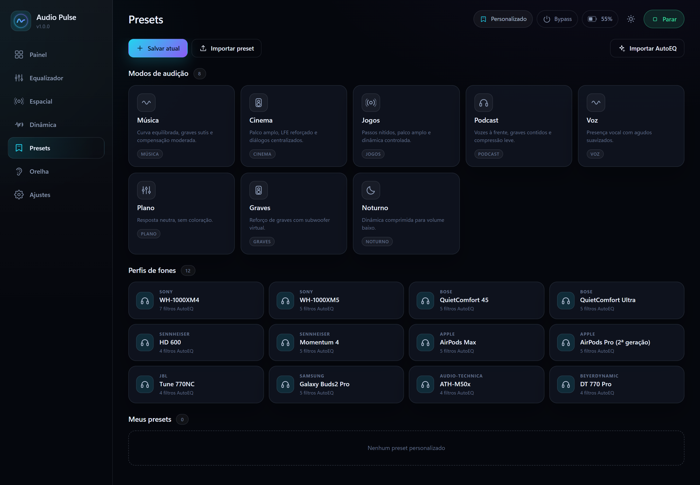
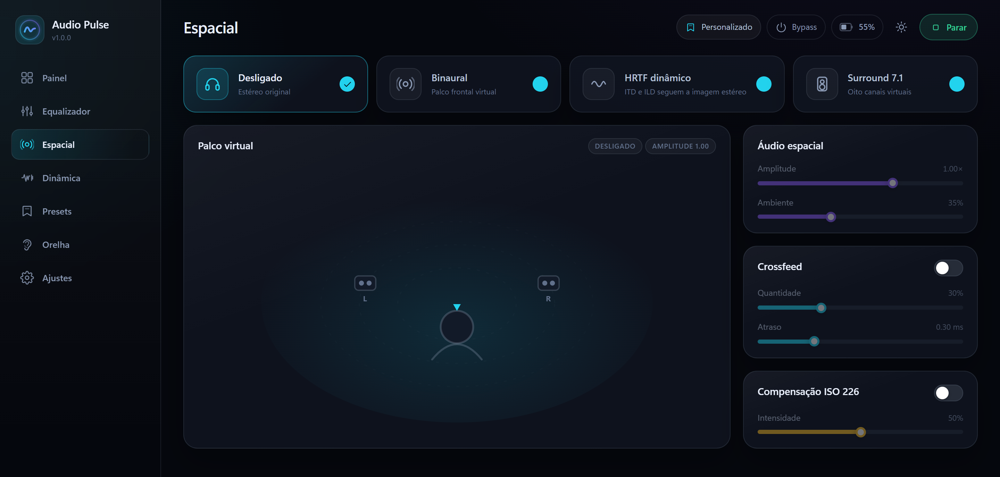
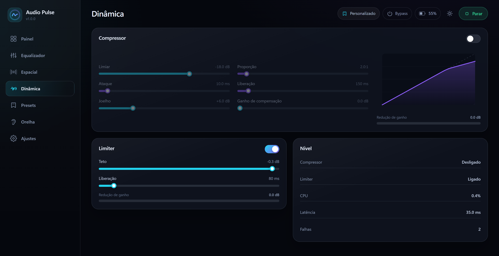
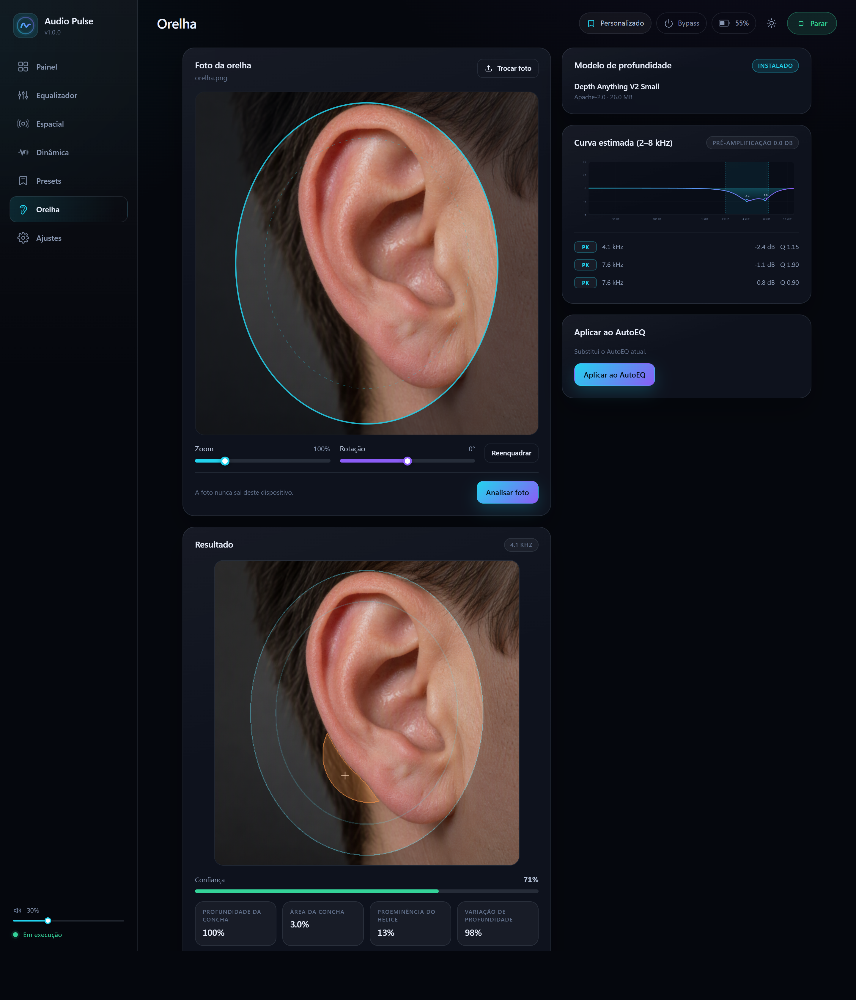
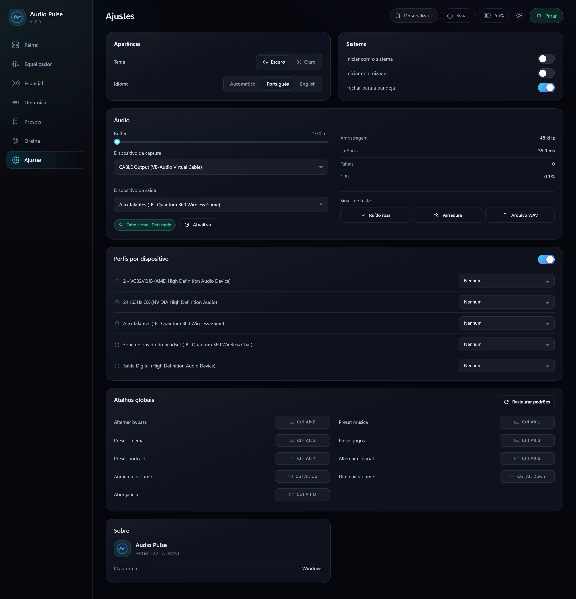

<div align="center">
  
</div>

<h3 align="center">Seus fones, ajustados para você — em todo o sistema.</h3>

<p align="center">
  Um motor DSP de baixa latência para todo som do computador: EQ de 10 bandas, AutoEQ paramétrico,<br/>
  síntese de graves, loudness ISO 226, HRTF dinâmico e perfil pela foto da orelha com IA local.
</p>

<p align="center">
  <a href="LICENSE"></a>
  
  
  
</p>

<p align="center">
  <a href="#recursos">Recursos</a> ·
  <a href="#capturas">Capturas</a> ·
  <a href="#compilar-do-c%C3%B3digo">Compilar</a> ·
  <a href="#como-funciona">Como funciona</a> ·
  <a href="docs/reference.pt-BR.md">Referência técnica</a> ·
  <a href="README.md">English</a>
</p>

[](docs/screenshots/dashboard.png)

## Por que Audio Pulse

A maioria dos ajustes de áudio só vale para o player que você está usando. O
Audio Pulse fica entre o sistema operacional e o fone: a mesma cadeia processa
música, jogos, chamadas e abas do navegador — com fio ou Bluetooth, sem driver
do fabricante e sem plugin por aplicativo.

O caminho de áudio é escrito em Rust e não aloca memória enquanto o som flui; a
interface React apenas desenha o estado e publica parâmetros por `ArcSwap`, então
arrastar um slider não pode travar a thread de áudio. Tudo roda na sua máquina:
sem conta, sem telemetria, sem processamento na nuvem.

## Recursos

| Som | Personalização | Integração com o sistema |
| --- | --- | --- |
| **EQ gráfico de 10 bandas** — 31 Hz a 16 kHz, ±12 dB, com curva de resposta ao vivo e nós arrastáveis | **Perfil da orelha** — modelo de profundidade local estima a concha e propõe correção de 2–8 kHz | **Rota para todo o sistema** — cabo virtual e troca automática da saída padrão no Windows |
| **AutoEQ paramétrico** — até 16 filtros PK/LS/HS, importação de `ParametricEQ.txt`, preamp | **Presets** — 8 modos de escuta e 12 perfis de fone de referência | **Volume sincronizado** — o slider do app e o volume do Windows são o mesmo controle |
| **EQ adaptativo** — 5 bandas de oitava a cada 20 ms, ±3 dB, headroom preditivo; determinístico, não é caixa-preta | **Presets personalizados** — criar, exportar e importar perfis JSON | **Perfis por dispositivo** — aplica um preset quando uma saída específica inicia |
| **Bass Boost** — low shelf e síntese de harmônicos pelo fenômeno do fundamental ausente | **Segurança do perfil** — AutoEQ anterior salvo, restauração em um clique | **Bandeja, atalhos, autostart** — controle sem abrir a janela |
| **Dinâmica** — compressor e limiter com look-ahead de 5 ms | | **Bateria sem fio** — relatório HID de receptores USB no Windows |
| **Loudness** — compensação ISO 226 que acompanha o volume master | | **Medidores reais** — espectro de 56 bandas, níveis L/R, redução de ganho, CPU, latência e xruns |
| **Áudio espacial** — binaural, HRTF dinâmico e upmix 7.1; crossfeed para fones | | **Interface** — dark/light, português e inglês, responsiva |

## Capturas

Clique em qualquer captura para abrir em resolução máxima.

| Equalizador | Presets |
| --- | --- |
| <a href="docs/screenshots/equalizer.png"></a> | <a href="docs/screenshots/presets.png"></a> |
| 10 bandas, tone, Bass Boost, loudness, crossfeed e AutoEQ na mesma cadeia. | Presets de modo, referências de fones, perfis personalizados e AutoEQ. |

| Áudio espacial | Dinâmica |
| --- | --- |
| <a href="docs/screenshots/spatial.png"></a> | <a href="docs/screenshots/dynamics.png"></a> |
| Binaural, HRTF dinâmico e surround virtual com largura e ambiente. | Compressor e limiter com look-ahead e curvas de transferência ao vivo. |

| Perfil da orelha | Ajustes |
| --- | --- |
| <a href="docs/screenshots/ear.png"></a> | <a href="docs/screenshots/settings.png"></a> |
| Recorte guiado, análise de profundidade local, confiança e proposta de AutoEQ reversível. | Dispositivos, rota, buffer, tema, idioma e atalhos globais. |

## Como funciona

```text
Qualquer aplicativo ──► cabo virtual ──► Audio Pulse ──► seu fone
                                            │
preamp → AutoEQ → EQ 10 → tone → graves → espacial → crossfeed
       → EQ adaptativo → compressor → volume → loudness → limiter
```

- **Um processo, uma thread de áudio.** O CPAL é dono dos streams de entrada e
  saída durante toda a sessão. Buffers, filtros e espectros são pré-alocados;
  mudanças de parâmetro trocam um ponteiro `ArcSwap` e reconstroem apenas os
  estágios afetados.
- **Troca de preset sem estalo.** Mudanças discretas descem a saída por 2 ms,
  aplicam os novos coeficientes em silêncio e sobem em 30 ms.
- **Correção de drift de clock.** Captura e reprodução podem ter taxas
  diferentes; um ring buffer com rastreio de drift (±0,15 %) absorve a diferença
  e conta xruns em vez de deixar a fila crescer.
- **Crate de DSP em Rust.** [`crates/audio-pulse-dsp`](crates/audio-pulse-dsp) é
  DSP puro, sem dependência de dispositivo: biquads RBJ, síntese de graves,
  renderizador espacial, EQ adaptativo, compressor, limiter, loudness ISO 226 e
  análise de espectro.

Feito com Tauri 2, Rust, React 19, TypeScript, Vite 8, CPAL, `ringbuf`,
`arc-swap` e ONNX Runtime (`ort`, vinculado estaticamente).

## Perfil pela foto da orelha, sem nuvem

A página **Orelha** guia um recorte de 512×512 do pavilhão e roda o
[Depth Anything V2 Small](https://huggingface.co/onnx-community/depth-anything-v2-small)
(ONNX int8, ~26 MB) na CPU local. Uma máscara de pele e uma bacia de
profundidade adaptativa localizam a concha; quatro métricas de geometria geram
uma correção paramétrica, e três filtros peaking em 2–8 kHz são propostos como
perfil de AutoEQ.

- A foto é decodificada, recortada e analisada **na sua máquina**; nunca é
  enviada e nenhuma chamada de rede acontece durante a análise.
- O modelo é baixado automaticamente na primeira vez que a página abre, direto
  do Hugging Face, e verificado por SHA-256 antes de ser usado.
- Aplicar o perfil é sempre explícito. O AutoEQ anterior é salvo antes e
  **Restaurar AutoEQ anterior** devolve exatamente o estado anterior.
- Baixa confiança, recorte descentralizado, concha ausente, foto escura ou
  estourada bloqueiam a aplicação em vez de adivinhar.

Isto é uma **estimativa**, não uma HRTF medida: uma foto 2D não contém o canal
auditivo, a sombra da cabeça nem a resposta individual da pinna. Trate a curva
como ponto de partida e compare com o **Bypass**. O método completo, os limites
e os critérios estão na
[referência técnica](docs/reference.pt-BR.md#como-funciona-o-perfil-por-foto-da-orelha).

## Privacidade

- Sem conta, sem analytics, sem telemetria, sem relatório de falhas.
- O áudio nunca sai da máquina.
- A rede só é usada quando você pede: download do modelo de profundidade na
  página Orelha e do instalador do cabo virtual no Windows/macOS. Ambos são
  verificados por checksum/assinatura.
- Configuração e presets são JSON no seu disco. Nada é sincronizado.

## Compilar do código

### Requisitos

| Plataforma | Ferramentas |
| --- | --- |
| Todas | Node.js 20.19+ ou 22.12+, npm, Rust stable via [rustup](https://rustup.rs) |
| Windows 10/11 | Visual Studio Build Tools com “Desenvolvimento para desktop com C++”, Windows SDK e runtime WebView2 |
| macOS 11+ | Xcode Command Line Tools (`xcode-select --install`) |
| Linux | `build-essential`, `libssl-dev`, `libwebkit2gtk-4.1-dev`, `libayatana-appindicator3-dev`, `librsvg2-dev`, `libasound2-dev` (nomes Debian/Ubuntu) |

```bash
git clone https://github.com/DouglasGDev/audio-pulse.git
cd audio-pulse

npm install
npm run tauri dev      # app desktop com hot reload
npm run tauri build    # binário de release + instalador

cargo test --workspace # DSP, parser AutoEQ, resampler, migração de config
npm run build          # type-check + frontend de produção
```

O executável de release fica em `target/release/audio-pulse` (`.exe` no
Windows); os instaladores em `target/release/bundle/`.

`npm run dev` abre a interface no navegador com um **backend simulado**: a
navegação e o layout funcionam, mas nenhum áudio é processado. Use para
desenvolver a interface, não para avaliar som.

### Rotear o som do sistema

O Audio Pulse não inclui driver de áudio. Para processar tudo, passe o sistema
por um cabo virtual:

1. **Windows** — em *Ajustes → Áudio*, clique em **Instalar cabo virtual**. O app
   baixa o pacote oficial do VB-CABLE, confere a assinatura Authenticode, executa
   o instalador (um pedido de administrador) e seleciona `CABLE Output` como
   captura. Enquanto a rota está ativa, a saída padrão do Windows vai para
   `CABLE Input` e é restaurada ao parar ou fechar.
2. **macOS** — instale o BlackHole 2ch pelo app, defina-o como saída do sistema,
   selecione-o como captura e o fone como saída.
3. **Linux** — crie um sink nulo e use o monitor como captura:

   ```bash
   pactl load-module module-null-sink sink_name=audiopulse \
     sink_properties=device.description=AudioPulse
   ```

Sem cabo? O painel toca ruído rosa, varredura ou um arquivo WAV direto na saída
processada, para avaliar a cadeia sem configurar rota.

## Atalhos padrão

| Ação | Atalho |
| --- | --- |
| Bypass ligado/desligado | `Ctrl/Cmd + Alt + B` |
| Música / Cinema / Jogos / Podcast | `Ctrl/Cmd + Alt + 1/2/3/4` |
| Alternar áudio espacial | `Ctrl/Cmd + Alt + S` |
| Volume + / − | `Ctrl/Cmd + Alt + ↑/↓` |
| Abrir janela | `Ctrl/Cmd + Alt + O` |

Todos podem ser redefinidos em *Ajustes → Atalhos*.

## Limitações conhecidas

- **É necessário um cabo virtual** para processar o sistema inteiro; não há APO,
  Audio Server Plugin nem filtro PipeWire neste projeto.
- **O AutoEQ é apenas paramétrico** — arquivos GraphicEQ e perfis FIR/convolução
  não são importados.
- **O áudio espacial é um modelo físico, não uma HRTF medida**; a externalização
  varia entre pessoas. O surround é um upmix estéreo, não decodificação 7.1.
- **O EQ adaptativo não corrige sala nem fone.** Ele equilibra o material em
  cinco bandas de oitava com um controlador determinístico.
- **Bateria e volume sincronizado são recursos do Windows.** Nas outras
  plataformas o volume master fica no DSP e não há leitura de bateria HID.
- **Windows é a plataforma de referência.** As builds de macOS e Linux usam o
  mesmo código portável de CPAL/Tauri; os passos de empacotamento e rota são os
  descritos acima.

## Contribuindo

Issues e pull requests são bem-vindos. Mantenha o caminho de áudio sem
alocações, rode `cargo test --workspace` e `npm run build` antes de abrir um PR e
evite dependências de nuvem em recursos que podem rodar localmente. As regras
estão em [CONTRIBUTING.md](CONTRIBUTING.md).

## Licença

O Audio Pulse é software livre sob a **GNU General Public License v3.0 ou
posterior**. Você pode usar, estudar, modificar e redistribuir; qualquer
derivado distribuído deve continuar aberto sob os mesmos termos. Veja
[LICENSE](LICENSE).

Componentes de terceiros e suas licenças estão em
[THIRD_PARTY_NOTICES.md](THIRD_PARTY_NOTICES.md). Os perfis de fone embutidos são
curvas de referência, não medições de laboratório, e o projeto não é afiliado a
fabricantes de fones.

<p align="center">
  Feito por <a href="https://github.com/DouglasGDev">Douglas Groff</a> ·
  <a href="https://github.com/DouglasGDev/audio-pulse/issues">Issues</a> ·
  <a href="README.md">Read in English</a>
</p>
